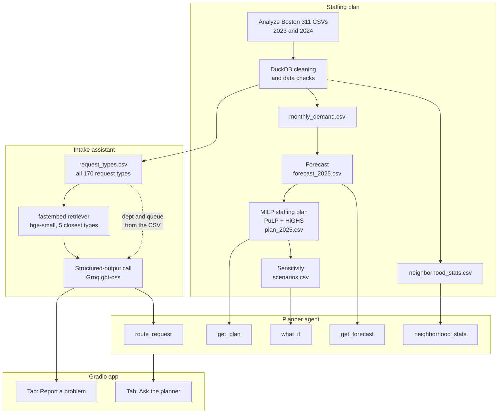

# Boston 311 Crew Planner

A month-by-month 2025 staffing plan for four City of Boston departments, built from real 311 service request data, with a GenAI intake assistant and a planner agent.

IE 5374 Hackathon, Northeastern University. Team of 3.

> **Status:** complete. The notebook was run top to bottom with `openai/gpt-oss-120b`, and every output is saved.

## What's in the repo

- `notebooks/boston311_crew_planner.ipynb`: the whole project, run top to bottom
- `report.md`: a short analysis of our decisions, assumptions and sensitivity results (added in BOS-6)
- `data/processed/`: small CSVs the notebook writes and later sections read
  - `request_types.csv`: every 2024 request type with its department and queue
  - `monthly_demand.csv`: requests per department per month, 2023–2024
  - `forecast_2025.csv`: forecast requests per department per month, 2025
  - `plan_2025.csv`: the staffing plan per department per month, 2025
  - `scenarios.csv`: cost, on-time estimate and peak crews for each sensitivity scenario
  - `neighborhood_stats.csv`: 2024 requests, on-time rate and median days by department, type and neighborhood
- `data/intake_test_set.csv`: 30 labeled messages for measuring the intake assistant
- `pyproject.toml`, `uv.lock`: the Python environment

## Departments in scope

| Department | Code | 2024 requests | On time, 2024 | Requests per crew per day | Annual cost per crew | Crews, Jan 2025 |
|---|---|---|---|---|---|---|
| Public Works | PWDx | 157,610 | 90% | 12 | $130,000 | 50 |
| Transportation | BTDT | 81,447 | 50% | 15 | $110,000 | 18 |
| Parks & Recreation | PARK | 18,736 | 93% | 6 | $120,000 | 10 |
| Inspectional Services | ISD | 18,624 | 72% | 4 | $140,000 | 16 |

Request counts and on-time rates come from the real data. Capacities, costs and starting crews are planning assumptions from the hackathon brief.

## Data

Public 311 service requests from [Analyze Boston](https://data.boston.gov/dataset/311-service-requests), the 2023 and 2024 files. The raw CSVs are too large for GitHub and are not committed; the notebook downloads them into `data/raw/` on the first run.

## Setup and run

1. Install [uv](https://docs.astral.sh/uv/getting-started/installation/). **On Windows, use WSL** and clone the repo into your Linux home (`~`), not under `/mnt/c`: the Windows drive is much slower for the data files and can change line endings.
2. Install the dependencies (Python 3.12 is fetched automatically):
   ```bash
   uv sync
   ```
3. Copy the environment file, then set your own [Groq](https://console.groq.com/keys) API key and the model in `.env`:
   ```bash
   cp .env.example .env
   ```
   ```
   GROQ_API_KEY=your-key
   LLM_MODEL=openai/gpt-oss-20b
   ```
   Use `openai/gpt-oss-20b` while developing and `openai/gpt-oss-120b` for the final run.
4. Start Jupyter, open `notebooks/boston311_crew_planner.ipynb`, and run all cells:
   ```bash
   uv run jupyter lab
   ```
   The first run downloads the data. LLM calls are cached in `data/cache/`, so reruns are free and give the same output.

## Architecture



The planning path uses only the four departments. The intake assistant chooses from all 2024 request types, and the department and queue always come from `request_types.csv`, never from the model. The agent's tools read only the CSVs, and the agent answers only with numbers they return.

## Results

From the notebook's Sections 4 and 5 (2025, all four departments):

| | Crew cost | Penalty | Total | On-time estimate |
|---|---|---|---|---|
| Staffing plan | $14,660,667 | $110,640 | **$14,771,307** | 98.0% |
| Hold-flat baseline (January crews all year) | $11,920,000 | $10,609,080 | **$22,529,080** | 56.7% |

**Transportation**, which the brief singles out for on-time improvement, goes from 18 to 26 crews. Its cost falls from $8,789,560 to $2,794,467, and its on-time estimate rises from 19.7% to 98.0%.

The on-time estimate is a model estimate (1 − backlog / demand), not the city's real on-time rate. The baseline's penalty is an upper bound, because with no hires its backlog keeps growing all year and the $100 late penalty is charged every month. Charged once, the baseline is $20,081,780 (Section 4 prints both), so the plan saves $5.31M to $7.76M.

**Sensitivity**, total 2025 cost ($M):

| Scenario | Re-planned | Base plan kept |
|---|---|---|
| Demand × 0.8 | 12.37 | 14.66 |
| Demand × 1.2 | 17.67 | 22.25 |
| Snowstorm (Public Works +35%, Jan–Feb) | 15.35 | 15.10 |
| Heat wave (Parks +40%, Public Works +10%, July) | 14.94 | 14.97 |

With demand 20% higher and the base plan kept, the on-time estimate falls to 21–44% across departments; re-planning holds it at 96–97%.

**Intake assistant accuracy** (Section 6, `gpt-oss-120b`, the 30 messages in `data/intake_test_set.csv`): the right request type for **23/30 (77%)** and the right department for **30/30 (100%)**. Six of the seven type misses were retrieval misses, where the right type wasn't among the 5 retrieved. All 3 non-311 messages went to `OUT_OF_SCOPE`.

**Planner agent examples** (Section 7):

| Question | Tools called | Answer |
|---|---|---|
| How many crews does Transportation have in August 2025, and how much does its plan cost for the year? | `get_plan` twice | 25 crews; $2,794,467 for the year |
| If demand is 20% higher, how do Parks' cost and on-time estimate compare between re-planning and keeping the base plan? | `what_if` | Re-planned $2,167,336 and 0.974; base plan kept $2,746,512 and 0.411 |
| Which neighborhood has the lowest on-time rate for Transportation, and what is that rate? | `neighborhood_stats` | West Roxbury, 0.365 |

## How we used AI

We used Claude to propose and compare approaches for the key decisions (the forecast method, the optimizer formulation and the intake design) and to help write code. Claude drafted most of the code for setup, the forecast, the staffing model and sensitivity, and the intake assistant, planner agent and app (Sections 0 and 3–8), and the first draft of Section 10 from our report. The data work, exploratory analysis and equity analysis (Sections 1, 2 and 9) are our own code, reviewed with Claude. In every section we chose among the options, reviewed the code, ran it, checked the results against the brief, and fixed what was wrong. The intake test set's labels were drafted with Claude and checked by hand. Inside the app, Groq's gpt-oss models produce the intake assistant's and the planner agent's responses. The assistant suggests a routing; it doesn't replace 311 staff, and its accuracy is measured on our test set in Section 6 of the notebook.

## Team

| Member | Notebook | Repo | Report | Video |
|---|---|---|---|---|
| Nishanth Manoharan ([@nishanth3112](https://github.com/nishanth3112)) | Setup (Section 0), intake assistant, planner agent and Gradio app (Sections 6–8), analysis and limitations (Section 10), final run | uv project, notebook skeleton, setup steps; reviewed the staffing and README PRs | Intake assistant paragraph and its limitations | Architecture walkthrough: diagram, intake assistant, agent tools, optimizer |
| Ramgopal Reddy Alumalla ([@ramg-0903](https://github.com/ramg-0903)) | Data download and checks against the brief, four exploratory charts, the 2025 forecast with a 2024 backtest (Sections 1–3), on-time rates by neighborhood and resident versus employee requests (Section 9) | Shared CSVs (`request_types`, `monthly_demand`, `forecast_2025`, `neighborhood_stats`) and the 30-message `intake_test_set.csv`, labeled from `request_types.csv`; reviewed the setup and GenAI app PRs | Compiled `report.md`; wrote the data, forecast and equity paragraphs | The problem |
| Aryan Patil ([@Aryan16d](https://github.com/Aryan16d)) | Staffing plan MILP and hold-flat baseline (Section 4), sensitivity scenarios (Section 5) | `plan_2025.csv` and `scenarios.csv`; HiGHS solver fix; README with the Mermaid architecture diagram; reviewed the BOS-2 (data and forecast) and BOS-6/BOS-7 (report and final run) PRs | Staffing plan and sensitivity paragraphs, with Transportation called out | Drives the product demo: the plan, a sensitivity result and the Gradio app |
